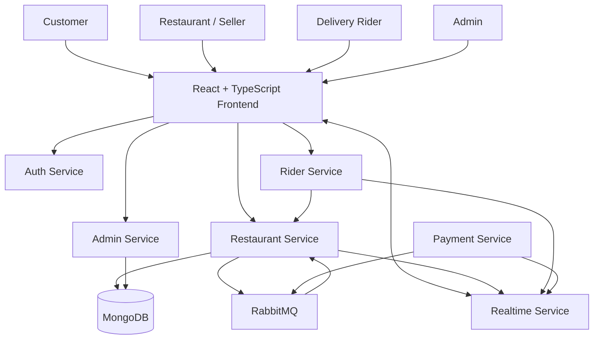

# 🍔 Zwigato — Food Delivery Platform

A full-stack food delivery platform built using **React, TypeScript, Node.js, Express, MongoDB and a Microservices Architecture**.

Zwigato connects customers, restaurants, and delivery riders through a real-time food ordering and delivery experience. It includes online payments, restaurant management, rider assignment, live order tracking, and an admin dashboard.

## 🌐 Live Demo

- **Frontend:** [Add your Vercel deployment URL]
- **GitHub Repository:** [Zwigato — GitHub]

## 📸 Screenshots

<!-- Add application screenshots here -->

| Customer Dashboard | Restaurant Dashboard |
|---|---|
| Add screenshot | Add screenshot |

| Rider Dashboard | Admin Dashboard |
|---|---|
| Add screenshot | Add screenshot |

## ✨ Key Features

### 👤 Customer
- User authentication and protected routes.
- Browse restaurants and explore food menus.
- Add items to cart and manage quantities.
- Manage delivery addresses.
- Place orders and make online payments.
- View order history and order status.
- Real-time order updates.
- Live rider location tracking.

### 🍽️ Restaurant / Seller
- Restaurant registration and management.
- Manage restaurant profile and availability.
- Manage food menus.
- Receive incoming customer orders.
- Update order preparation and fulfilment status.
- Receive real-time order notifications.
- Track rider assignment and order progress.

### 🛵 Delivery Rider
- Rider authentication and dashboard.
- Toggle availability.
- Receive incoming delivery requests in real time.
- Accept delivery orders.
- Update delivery status.
- Share live GPS location.
- View current delivery information.

### 🛠️ Admin
- Administrative dashboard.
- Restaurant verification and management.
- Rider management.
- Platform-level operational controls.

### ⚡ Real-Time Functionality
- Socket.IO-powered real-time communication.
- New order notifications.
- Rider assignment notifications.
- Live rider location updates.
- Dedicated user and restaurant socket rooms.

### 💳 Payment Integration
- Razorpay integration.
- Stripe checkout integration.
- Payment verification.
- RabbitMQ-based payment event processing.

## 🧰 Tech Stack

| Category | Technologies |
|---|---|
| Frontend | React, TypeScript, Vite, Tailwind CSS |
| Backend | Node.js, Express.js, TypeScript |
| Database | MongoDB, Mongoose |
| Authentication | JWT |
| Real-time | Socket.IO |
| Message Broker | RabbitMQ |
| Payments | Razorpay, Stripe |
| Maps & Location | Leaflet, Browser Geolocation |
| Containerization | Docker |
| Frontend Deployment | Vercel |
| Backend Deployment | Render |
| Infrastructure | AWS EC2, RabbitMQ |

## 🏗️ Architecture

Zwigato follows a microservices architecture, separating major business functionalities into independent backend services.

### Backend Services

| Service | Responsibility |
|---|---|
| Auth Service | Authentication and user management |
| Restaurant Service | Restaurants, menus, carts, addresses and orders |
| Rider Service | Rider availability, order acceptance and delivery |
| Admin Service | Administrative operations |
| Realtime Service | Socket.IO connections and real-time event communication |
| Utils / Payment Service | Payment processing and verification |

### System Architecture



## 🔄 Order Workflow

1. Customer selects a restaurant and adds food items to the cart.
2. Customer proceeds to checkout and completes payment.
3. Payment verification is processed by the backend.
4. RabbitMQ handles payment-related events.
5. Restaurant receives the new order notification.
6. Restaurant prepares the order and marks it ready for delivery.
7. Available riders receive delivery requests.
8. A rider accepts the order.
9. Customer and restaurant receive real-time assignment updates.
10. Rider location is shared through the real-time service.
11. Order status is updated throughout the delivery process.

## 🚀 Getting Started

### Prerequisites

Make sure you have installed:

- Node.js
- npm
- MongoDB connection
- RabbitMQ instance
- Git

### 1. Clone the repository

```bash
git clone https://github.com/Aditya-govil007/Zwigato---Zomato_Clone.git
```

```bash
cd Zwigato---Zomato_Clone
```

### 2. Install frontend dependencies

```bash
cd frontend
npm install
```

### 3. Configure environment variables

Create the required `.env` files for the frontend and individual backend services.

Frontend environment variables may include:

```env
VITE_AUTH_SERVICE_URL=
VITE_RESTAURANT_SERVICE_URL=
VITE_RIDER_SERVICE_URL=
VITE_ADMIN_SERVICE_URL=
VITE_REALTIME_SERVICE_URL=
VITE_UTILS_SERVICE_URL=
VITE_STRIPE_PUBLISHABLE_KEY=
```

Backend services require their respective configuration, including:

```env
MONGO_URI=
JWT_SEC=
RABBITMQ_URL=
INTERNAL_SERVICE_KEY=
RAZORPAY_KEY_ID=
RAZORPAY_KEY_SECRET=
STRIPE_SECRET_KEY=
FRONTEND_URL=
```

**Important:** These are configuration examples, not a complete environment-variable specification. Refer to each service's implementation for its exact required variables. Never commit actual credentials or secrets to GitHub.

### 4. Run the frontend

```bash
cd frontend
npm run dev
```

The Vite development server will display its local URL, typically:

```text
http://localhost:5173
```

### 5. Run backend services

Each backend microservice has its own dependencies and environment configuration.

Navigate to the respective service directory, install its dependencies, and use the development script defined in its `package.json`.

## ☁️ Deployment

The project uses the following deployment setup:

| Component | Platform |
|---|---|
| Frontend | Vercel |
| Backend Microservices | Render |
| RabbitMQ | AWS EC2 |
| Database | Hosted MongoDB |

Environment variables and service URLs are configured separately for the deployed environments.

## 🔐 Security

- JWT-based authentication.
- Role-based access control.
- Protected backend routes.
- Environment-based configuration.
- Internal service authentication.

Sensitive credentials should always remain in environment variables and must never be exposed in frontend code or committed to the repository.

## 🧠 Engineering Highlights

Some of the key engineering concepts implemented in Zwigato:

- Microservices architecture and service-to-service communication.
- Event-driven processing with RabbitMQ.
- Real-time communication using Socket.IO.
- JWT authentication and role-based authorization.
- Payment gateway integration and verification.
- Geolocation and live rider tracking.
- Docker-based service containerization.
- Independent frontend and backend deployment.

## 🔮 Future Improvements

- Automated testing and integration testing.
- Centralized logging and monitoring.
- API documentation with Swagger.
- Improved service observability.
- CI/CD pipeline automation.
- Performance optimization and caching.

## 👨‍💻 Author

**Aditya Govil**

Full-Stack Developer

- GitHub: [Aditya-govil007](https://github.com/Aditya-govil007)
- Portfolio: Coming Soon

---

⭐ If you find this project interesting, consider giving the repository a star!
